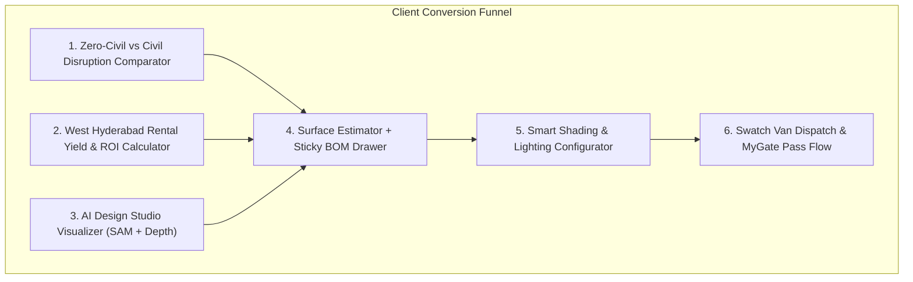

# Concepts Brief: Aura Makeover — Strategic Pivot to Zero-Civil Architectural Transformation

**Date:** 2026-11-05  
**Status:** In Brainstorming / EGM Clarification  
**Target Architecture:** Next.js 16 + Tailwind CSS v4 + GSAP 3 + Framer Motion + Prisma Proxy  

---

## 1. Problem Statement & Core Hypothesis

### The Friction Point
Homeowners and high-rise landlords in West Hyderabad (Kokapet, Financial District, Tellapur) want high-end interior finishes (acoustic slat louvers, European wall textiles, motorized shading, pooja backdrops), but traditional renovations create 45–90 days of noise, dust, builder society NOC friction, contractor delays, and living displacement.

### The Strategic Shift
* **Retiring the Rigid Clock:** Shifting away from a rigid "48-Hour" promise to avoid operational liabilities, weather/freight delays, and false expectations.
* **New Positioning:** **"Rapid Surface Makeover"**, **"Zero-Civil Transformation"**, and **"100% Live-In Friendly / Dust-Free Upgrade"** (inspired by *Plum Living* front-end skins and *Block Renovation* automated BOM back-end).
* **Target Audience Segmentation:**
  1. **Owner-Occupiers:** Live-in friendly, zero dust, no need to relocate to an Airbnb or pack up furniture.
  2. **Landlords / NRI Investors:** Rapid turnaround to eliminate vacant months, rental yield lift (+₹12k–₹20k/month), and 6–9 month capex payback.

---

## 2. Six Target Interactive Applications

1. **Rapid Surface Makeover Estimator (`EstimatorGateway.tsx`):**
   - 3-step wizard (Dimensions $\rightarrow$ Finishes $\rightarrow$ Smart Add-ons).
   - Sticky live Bill of Materials (BOM) drawer updating live material, labor, primer, and GST breakdown.
2. **Zero-Civil vs. Traditional Renovation Cost & Disruption Comparator:**
   - Exposes hidden costs: temporary rental/Airbnb expenses, post-renovation deep cleaning, and project overrun days.
   - Persona toggle: "Owner Living in Flat" vs. "Vacant / Investment Unit".
3. **West Hyderabad Rental Yield & ROI Calculator:**
   - Computes rental premium (+₹12,000 to ₹20,000/month in high-rises like My Home Bhooja, Prestige High Fields).
   - Payback timeline (6–9 months) and 3-year net capital appreciation.
4. **Smart Shading & Architectural Lighting Configurator:**
   - Multi-window motorized smart blinds (Matter/Zigbee wireless protocol).
   - Surface-mounted 3000K warm LED cove extrusions without dropping ceilings.
5. **AI Design Studio Visualizer:**
   - Interactive Before/After drag slider with wall segmentation.
   - Day/night ambient lighting simulator.
6. **Swatch Van Booking & WhatsApp Gate Pass Flow:**
   - Integrates with AiSensy to dispatch physical van slots.
   - Generates MyGate / NoBrokerHood visitor entry passes automatically.

---

## 3. Stress-Test Critique & Architectural Constraints

### A. E2E Test Contract Invariance (Gate 1 Guardrail)
* `scripts/test-e2e.mjs` currently contains 117 passing tests, several of which pin strings like `"48 Hours"`, `"48hr Guarantee"`, and `"48-Hour Method"`.
* **Action:** Any terminology shift from "48 Hours" to "Rapid Surface Makeover" must be coordinated with matching updates in `scripts/test-e2e.mjs` so Gate 1 does not break.

### B. Mathematical Determinism (Engines)
* Pricing calculations must remain strictly pure functions in `src/lib/engines.ts`.
* The ROI and Yield models must use localized West Hyderabad rental data constants rather than client-side arbitrary estimations.

### C. Operational Complexity of the "MyGate Pass Flow"
* Direct API integration with MyGate/NoBrokerHood is typically restricted to enterprise security partnerships.
* **Realistic Implementation:** Generate a pre-filled visitor registration deep-link or a standardized WhatsApp pass text that the resident forwards to their society gate in one tap.

---

## 4. Next Step in Ideation
Identify which of the 6 core applications represents the highest immediate conversion leverage to specify and architect first.
